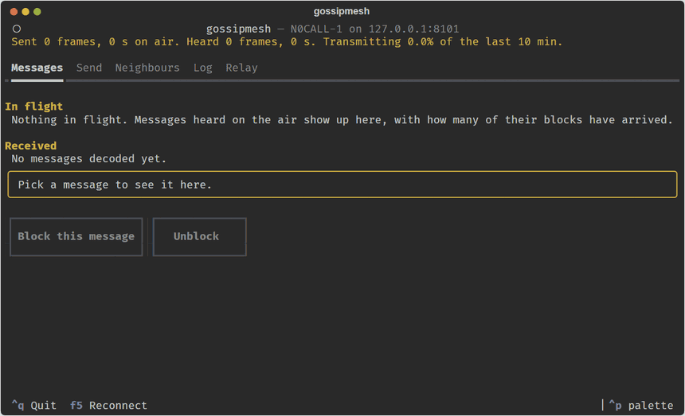
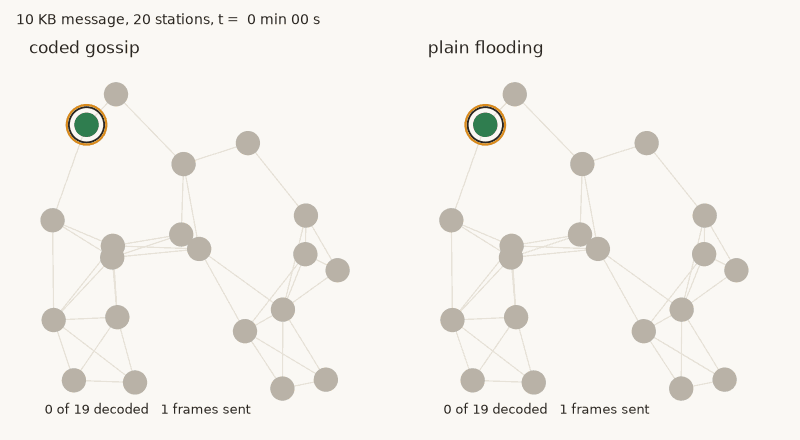

<h1 align="center">gossipmesh</h1>

<p align="center">
<b>Get a message to every station in a packet radio network with no routes, connections or
per-packet ACKs.</b>
</p>

<p align="center">
<a href="https://github.com/Londopy/gossipmesh/actions/workflows/ci.yml"></a>
<a href="https://github.com/Londopy/gossipmesh/releases/latest"></a>
<a href="https://pypi.org/project/gossipmesh/"></a>
<a href="https://pypi.org/project/gossipmesh/"></a>
<a href="CHANGELOG.md"></a>
<a href="LICENSE"></a>
<br>
<a href="https://pypistats.org/packages/gossipmesh"></a>
<a href="https://github.com/Londopy/gossipmesh/releases"></a>
<a href="https://github.com/Londopy/gossipmesh/commits/main"></a>
<a href="https://github.com/astral-sh/ruff"></a>
<a href="https://mypy-lang.org/"></a>
<a href="https://github.com/Londopy/gossipmesh/actions/workflows/ci.yml"></a>

</p>

<p align="center">

<br>
<sub><code>gossipmesh tui</code> on the bench: three Direwolf modems at 1200 baud on a virtual audio cable. Real frames, no radios, sped up.</sub>
</p>

A message is cut into blocks, and every packet on the air is a random mix of those blocks
(random linear network coding over GF(256)). Stations keep whatever they hear, from anyone,
and send fresh mixes of it on to their neighbours before they can decode anything. A station
decodes once it holds enough independent mixes, whichever stations they came from. Stations
announce how much they hold, so they stop sending once everyone nearby has the message.
After that, only a short beacon goes out every 5 to 10 minutes, for stations that join late.

> [!NOTE]
> It has been tested in a simulator and on a bench of three Direwolf modems at 1200 baud
> sharing a virtual audio cable. It has not been used on the air yet, and 9600 baud has only
> been simulated, never run on a modem. See [Before going on the air](#before-going-on-the-air).

## Quick start

```bash
pip install "gossipmesh[all]"
gossipmesh sim --runs 10
gossipmesh tui --call N0CALL-1 --kiss 127.0.0.1:8101
```

The first command needs no radio: it compares the strategies on simulated maps. The second
runs a station with a live view, and needs a KISS TNC listening on that port, such as
Direwolf (see [Bench test with a real modem](#bench-test-with-a-real-modem)).
`gossipmesh node` takes the same options and prints lines instead.

<details>
<summary><b>New to packet radio, or to network coding?</b></summary>

| Term | Meaning |
|---|---|
| TNC | The modem between a computer and a radio. KISS is the simple protocol a computer uses to hand it frames, over TCP or a serial port. |
| Direwolf | A software TNC that uses a sound card as the modem. |
| `N0CALL-1` | A call sign with an SSID, so one operator can run several stations. N0CALL is the placeholder call sign; use your own. |
| Part 97 | The US amateur radio rules. |
| Block, generation | A message is cut into blocks of 128 bytes by default, grouped into generations of up to 32. Coding mixes blocks within one generation. |
| Rank | How many independent mixes of a generation a station holds. It can decode the generation when the rank equals the number of blocks. |
| Back-off | The random wait before a station answers a neighbour that is missing pieces, so neighbours don't all answer at once. |

</details>

## What's here

| | |
|---|---|
| 📜 **Protocol** | Written up in [docs/protocol.md](docs/protocol.md) so anyone can decode it. |
| 📡 **`gossipmesh node`** | Runs a station against a KISS TNC over TCP (Direwolf, UZ7HO soundmodem) or a serial port. The station code does no I/O, so the simulator and the radio run the same code. |
| 🖥️ **`gossipmesh tui`** | The same station with a live view in the terminal: messages arriving block by block, what it has decoded, its neighbours, its airtime, and controls for sending and relaying. |
| 🗺️ **`gossipmesh sim`** | Stations scattered on a map, with packet loss that rises toward the edge of range, channel access that behaves like Direwolf's, collisions and hidden stations. It compares coded gossip with the same protocol uncoded, plain flooding, and point-to-point forwarding. |
| ✍️ **Signatures** | Optional Ed25519. They prove who sent a message, and the content stays readable. |
| 📚 **Background** | A short [prior-art survey](docs/prior-art.md), and readings of the [US rules](docs/part97.md) and [rules elsewhere](docs/rules-elsewhere.md). |

## Install

```bash
pip install "gossipmesh[all]"
```

Python 3.10 or newer, on any OS. Without extras you get the simulator and `gossipmesh node`
over KISS TCP, with only numpy as a dependency. The extras can be installed one at a time:

| Extra | Pulls in | For |
|---|---|---|
| `sign` | `cryptography` | Ed25519 signatures |
| `serial` | `pyserial` | serial TNCs |
| `tui` | `textual` | the terminal view |
| `all` | all of the above | |

Every [GitHub release](https://github.com/Londopy/gossipmesh/releases/latest) also has the
wheel and source archive, `SHA256SUMS.txt` with the SHA-256 of every file, and a torrent per
file.

From a checkout, for development:

```bash
pip install -e ".[all,dev]"
pytest
```

## Simulate

<p align="center">
<picture>
<source media="(prefers-color-scheme: dark)" srcset="https://raw.githubusercontent.com/Londopy/gossipmesh/main/docs/images/sim-dark.gif">

</picture>
<br>
<sub>The simulator's default map (seed 1): one 10 KB message from the circled station, coded gossip against plain flooding. A ring marks a station transmitting; green means decoded.</sub>
</p>

```console
$ gossipmesh sim --runs 10
strategy  delivered  frames  airtime s  air/delivery s  median s  farthest s  quiet at s  heard/block
coded     190/190    1999    2726       143.5           1193      2185        3185        1.54
uncoded   190/190    3070    4047       213.0           1773      2586        3548        2.50
flood     0/190      389     550        -               -         -           399         -
routed    105/190    13720   15818      1506.5          12001     20098       21599       -
```

The default map is 20 stations on a square 3 radio ranges wide, sending a 10 KB message at
1200 baud with 128-byte blocks and 10% loss inside range. Every strategy runs on the same
maps. `gossipmesh sim --help` lists the knobs (`--stations`, `--area`, `--loss`, `--baud`,
`--size`, `--block`, `--strategy`).

<details>
<summary><b>What the columns mean</b></summary>

- **delivered:** stations that ended up with the whole message, summed over runs.
- **airtime s:** total channel time used per run, all stations added up.
- **air/delivery s:** airtime divided by stations reached.
- **median s** and **farthest s:** time until a station decodes, and until the last one does.
- **quiet at s:** when the last frame went out. With coded gossip the gap after "farthest" is
  completed stations repeating a short status a few times. The simulator turns beacons off,
  since every simulated station is there from the start.
- **heard/block:** data frames a station heard before it could decode, divided by the
  number of blocks in the message. 1.00 would mean nothing was wasted.

</details>

### Coded against uncoded

The comparison that matters is with **uncoded**. That is the same protocol with coding
switched off: the same generations, timers, back-off and opening push. A data frame carries
the sender's bitmap for that block's generation where a coded packet carries its rank, and a
status carries bitmaps where a coded status carries ranks. Neighbours resend the plain
blocks a bitmap shows missing. Both reached every station on every map tried. At the default
back-off, coding saved between 18% and 33% of the airtime, and the farthest station decoded
a little sooner:

| Scenario | Coded airtime | Uncoded airtime | Coded / uncoded | Farthest decode, coded vs uncoded |
|---|---|---|---|---|
| default (1200 baud, 10% loss) | 2,726 s | 4,047 s | 67% | 2,185 s vs 2,586 s |
| `--loss 0.3` | 3,776 s | 5,138 s | 73% | 3,295 s vs 3,452 s |
| `--area 3.5`, 30 runs | 2,453 s | 3,214 s | 76% | 2,604 s vs 3,057 s |
| `--area 4.0`, 30 runs | 2,534 s | 3,079 s | 82% | 3,124 s vs 3,185 s |
| `--baud 9600 --txdelay 0.1 --block 256` | 325 s | 423 s | 77% | 375 s vs 490 s |

<details>
<summary><b>How the back-off changes the saving</b></summary>

How big the saving is depends on the back-off, the random wait before a station answers a
neighbour's deficit. Longer waits let stations overhear each other and skip redundant
frames, which helps both strategies and helps uncoded more. On the default map, 10 runs per
row, with the back-off in units of one packet's airtime (`gossipmesh sim --backoff`):

| Back-off | Coded airtime | Uncoded airtime | Coded / uncoded | Farthest decode, coded vs uncoded |
|---|---|---|---|---|
| 0.4 | 4,148 s | 8,114 s | 51% | 2,033 s vs 2,852 s |
| 1 | 3,911 s | 6,733 s | 58% | 1,971 s vs 2,578 s |
| 2 | 3,921 s | 5,605 s | 70% | 2,350 s vs 2,527 s |
| **4 (default)** | 2,726 s | 4,047 s | 67% | 2,185 s vs 2,586 s |
| 8 | 2,210 s | 2,470 s | 89% | 2,747 s vs 2,375 s |
| 16 | 1,719 s | 2,010 s | 85% | 3,102 s vs 3,441 s |

Past 4 both strategies keep saving airtime and coding's lead shrinks to 10-15%, but the
farthest station waits longer: at 8, coded's farthest decode on the default map took 2,747 s
against 2,185 s at 4, and slower than uncoded's. The sparser `--area 4` map shows the same
pattern, from 82% at 4 to 90% at 8 and 93% at 16. That is why the default is 4.

</details>

These are simulator results from a guessed loss model, so treat the exact figures with
suspicion; the bench test below checks the protocol itself, not the comparison.

### Against plain flooding

Plain flooding here means each station repeats each block once, with no repair. Meshtastic
floods in a smarter way: a node skips its rebroadcast if it hears a neighbour rebroadcast
first, a hop limit caps how far a packet goes, and a message is a single packet of at most
239 bytes. The simulator models none of that, so treat this as plain flooding, not as
Meshtastic. On the default map flooding used a fifth of coded's airtime but reached no station
at all: with 79 blocks, losing any one of them means failure.

<details>
<summary><b>Where flooding does work</b></summary>

Airtime per station reached on the default map over 10 runs per cell, with the share of
stations reached in brackets. `--loss` is the loss inside range; loss still rises toward the
edge of range, and collisions still happen at 0.

| Message | `--loss 0` | `--loss 0.02` | `--loss 0.05` | `--loss 0.1` |
|---|---|---|---|---|
| 500 bytes, 4 blocks, coded | 7.7 s (100%) | 8.4 s (100%) | 7.9 s (100%) | 9.7 s (100%) |
| 500 bytes, 4 blocks, flood | 6.7 s (73%) | 8.2 s (56%) | 9.7 s (45%) | 9.9 s (44%) |
| 2,000 bytes, 16 blocks, coded | 18.7 s (100%) | 18.1 s (100%) | 18.8 s (100%) | 20.0 s (100%) |
| 2,000 bytes, 16 blocks, flood | 1,265 s (1%) | 1,257 s (1%) | none | none |
| 10,000 bytes, 79 blocks, coded | 152 s (100%) | 161 s (100%) | 157 s (100%) | 144 s (100%) |
| 10,000 bytes, 79 blocks, flood | none | none | none | none |

So the airtime target fails in one corner. For a message of a few blocks on a perfectly
clean channel, flooding spends less airtime per station it reaches, though it misses a
quarter of them. At 2% loss the two cost about the same, and from 5% loss up, or from a
couple of kilobytes up, coded gossip costs less per delivered message while flooding soon
delivers nothing at all. Over more runs a few coded stations miss a 500-byte message too:
stations that heard nothing during the short opening burst, so never learned it existed. On
the air, beacons reach them; the simulator runs without beacons.

</details>

### Routed forwarding

Routed forwarding sends one copy per destination along shortest paths, with stop-and-wait
ARQ per hop and routes given for free. On the default map it used almost six times coded's
airtime and reached 105 of 190 stations before the 6-hour limit.

At 9600 baud with 256-byte blocks, routed forwarding also reached every station, using
almost nine times coded's airtime and taking 15 times as long. Flooding reached none.

### How many packets it takes

The design target was about K + 2 packets to decode K blocks. The code alone does better.
Over 2,000 generations each of 8, 16 and 32 blocks, built from random seeded packets, a
generation needed one extra packet 0.2% to 0.55% of the time and never two. On average that
is between K + 0.002 and K + 0.006.

On a network, stations hear more than they need, because several neighbours send at once and
their mixes overlap. That is the heard/block column above: 1.54 for coded gossip on the
default map, 2.50 for the same protocol uncoded, and 1.35 and 2.13 at 9600 baud.

One part of the design could not be met as planned. Packets carry a 4-byte seed instead of
their coefficients only when the sender holds the whole generation. A relay that has not
decoded yet sends a mix of mixes, which a seed can almost never describe, so it sends the
coefficient vector: up to 32 bytes. Over 10 runs on the default map those vectors cost 4.6%
of all airtime beyond what a seed would, which is the most any compact form could win back.
[docs/protocol.md](docs/protocol.md#known-limits) has the details.

<details>
<summary><b>Reproducing these numbers</b></summary>

Every run is seeded, so these commands print the numbers above:

```bash
gossipmesh sim --runs 10
gossipmesh sim --runs 10 --baud 9600 --txdelay 0.1 --block 256
gossipmesh sim --runs 30 --area 3.5 --strategy coded --strategy uncoded
gossipmesh sim --runs 10 --loss 0.3 --strategy coded --strategy uncoded
python scripts/figures.py backoff
python scripts/figures.py flood
python scripts/figures.py decode
python scripts/figures.py vectors
```

The simulator's channel access was corrected after the bench test below showed how
Direwolf behaves.

</details>

## Bench test with a real modem

Run two or three Direwolf instances, each with its own `MYCALL`, `KISSPORT` and `AGWPORT`.
Connect their audio through loopback, for example with a virtual audio cable, or wire the
radios into dummy loads. A Direwolf config for one station on a shared virtual cable looks
like this:

```
ADEVICE 1 4
ACHANNELS 1
CHANNEL 0
MYCALL N0CALL-1
MODEM 1200
KISSPORT 8101
AGWPORT 8100
```

> [!WARNING]
> `ADEVICE` takes the input and output device numbers Direwolf lists at startup. Windows can
> renumber them after a reboot or when a headset connects, so check the list again if the
> modems stop hearing each other.
>
> Give every instance its own pair of ports, and keep them away from 8001. On the bench,
> Direwolf 1.8.1 also opened its default KISS port 8001 alongside the configured one, so
> whichever instance started first took 8001, and a node pointed at 8001 could end up on the
> wrong modem.

Then start one node per Direwolf:

```bash
gossipmesh node --call N0CALL-1 --kiss 127.0.0.1:8101 --out received --send notes.txt
```

```bash
gossipmesh node --call N0CALL-2 --kiss 127.0.0.1:8111 --out received2
```

Each node prints a line when it decodes a message, followed by the text itself when the
message is short plain text, and saves the body under `--out`, named by message id. A
hardware TNC in KISS mode works with `--serial COM3 --serial-baud 9600`. For 9600 baud
radios, pass `--baud 9600` so the node paces itself to the channel.

To send more messages while a node runs, start it with `--outbox DIR`. Every file dropped
into DIR goes out as a message (signed, with `--key`) and then moves to `DIR/sent`. A node
that holds a complete message beacons it every 5 to 10 minutes until it expires. A station
that comes on the air late still gets it, and neighbours that hear each other's beacons
send only one between them. A beacon is about half a second of airtime at 1200 baud, so many
live messages add up: `--beacon SECONDS` sets the interval, and `--beacon 0` turns beacons
off. A file the node cannot send, such as one over the 64 KB limit, moves to `DIR/failed`
with an error, and the node carries on.

For a node left running unattended, three options cover what Part 97 asks of a relay (see
[docs/part97.md](docs/part97.md)):

| Option | What it does |
|---|---|
| `--log FILE` | Keeps every frame sent and heard. `gossipmesh decode FILE --out DIR` recovers the messages from it later. |
| `--blocklist FILE` | Takes message ids, one per line, and the node stops relaying them as soon as the file changes. Deleting a line lifts the block. The node prints each change, and `decode` marks blocked messages. |
| `--relay-trusted-only` | With `--trust`, relays only messages signed by a trusted key, after decoding them. Anything it cannot verify it never passes on, and trusted messages get through it more slowly, because it can no longer pass on pieces before it has the whole message. |

### What the bench showed

Three Direwolf 1.8.1 instances at 1200 baud shared one virtual audio cable on Windows, so
every station heard every other one. No radios were involved.

| Run | Result |
|---|---|
| 2 KB, final code | ✅ both receivers in 29 s |
| 10 KB, final code | ✅ both receivers in 129 s |
| 10 KB, after the jitter fix | ✅ both receivers in 204 s, at about 8% loss |
| 10 KB, first attempt | ❌ never finished: the receivers' requests collided every round |

<details>
<summary><b>What happened on each run</b></summary>

- The first 10 KB run never finished. A quarter of the frames were lost on the cable, so the
  receivers had to ask for more. Both had heard the same frames at the same moments, so
  their status timers expired together. Direwolf sends at once when the channel is clear,
  so the two requests collided on every round, and the sender never heard one. Status
  timers now carry random jitter, and the simulator now models this channel access.
  Without the fix it reproduces the stall.
- With the fix, a 10 KB message reached both receivers in 204 seconds, at about 8% loss.
  The sender sent 91 frames, an opening burst of 85 and 6 repairs after each receiver asked
  twice.
- On the final code (back-off of 4 packet times, opening burst sent back to back) a 2 KB
  message reached both receivers in 29 seconds and a 10 KB message in 129 seconds. Loss was
  low on that run, 2 of 85 frames, so the opening burst's 2 spare frames per generation
  covered it and nobody had to ask. 85 frames take about 125 seconds of airtime at
  1200 baud, so delivery came as soon as the burst ended.

</details>

## Live view in the terminal

```bash
gossipmesh tui --call N0CALL-1 --kiss 127.0.0.1:8101 --log frames.log --blocklist blocked.txt
```

`gossipmesh tui` takes every option `gossipmesh node` does and runs the same station, with a
view of what it is doing instead of lines of output. It works over SSH, which suits a node
left by a radio.

| Tab | Shows |
|---|---|
| **Messages** | Every message in flight with how much of it has arrived ("40 of 64"), and the messages decoded so far. Pick one to read it, or to block or unblock it. |
| **Send** | Type a message or give the path of a file, and see what this node has sent. |
| **Neighbours** | Every station heard, with when it was last heard and how many frames. |
| **Log** | Every frame sent and heard, and every block, unblock and decode, as they happen. |
| **Relay** | Switch trusted-only relaying on or off (it needs `--trust`), and see the settings and the blocked messages. |

The line under the title counts frames and airtime sent and heard, and how much of the last
10 minutes this node spent transmitting. Messages, notices and errors show there too,
whichever tab is open, and in the Log tab. Blocking from the view edits the `--blocklist`
file when there is one, so the block survives a restart; without one it lasts until the node
stops.

Keys: <kbd>Ctrl</kbd>+<kbd>Q</kbd> quits, <kbd>F5</kbd> reconnects after the TNC drops, and
<kbd>Tab</kbd> moves between controls.

The colours are the terminal's own: the view uses its light or dark variant to match the
terminal when it sets `COLORFGBG`, or else the Windows or macOS setting. Elsewhere it assumes
a dark terminal unless `COLORFGBG` says otherwise.

## Signing

```bash
gossipmesh keygen n0call.pem --call N0CALL-1
```

This writes the private key and prints a `N0CALL-1 <public key>` line. Collect those lines
from the stations you trust into a file. Then sign with `--key n0call.pem` and check with
`--trust trusted.txt`. Nodes drop a message whose signature fails for a key they hold. A
message signed by a key they don't hold is delivered and marked untrusted.

> [!CAUTION]
> Keep the `.pem` file to yourself. Anyone with it can sign as you.

## Before going on the air

> [!IMPORTANT]
> Nobody has run gossipmesh on the air yet.

Running 3 to 5 stations on the air, and a field test on 2 m simplex timing how long the
farthest station takes to decode, are still to do. Both need licensed operators and radios.
The field test will also be the first time relays out of the sender's range have to re-mix
pieces they cannot decode yet; on the bench every station was in range of the sender.

Read [docs/part97.md](docs/part97.md), a section-by-section reading of the US rules checked
against eCFR on 2026-11-19. In short: unattended relaying of data is allowed on 6 m and up,
and only in a few narrow segments on HF. A gossipmesh network counts as a message forwarding
system, so originators answer for content, and signatures are how relays authenticate them.
The protocol is public and unencrypted, and every frame carries the sending station's call
sign. It is not legal advice. For the UK, Canada, Australia, Germany and Japan, see
[docs/rules-elsewhere.md](docs/rules-elsewhere.md).

## License

Apache-2.0. See [LICENSE](LICENSE). It includes a patent grant, which matters for a protocol
other people may implement.
